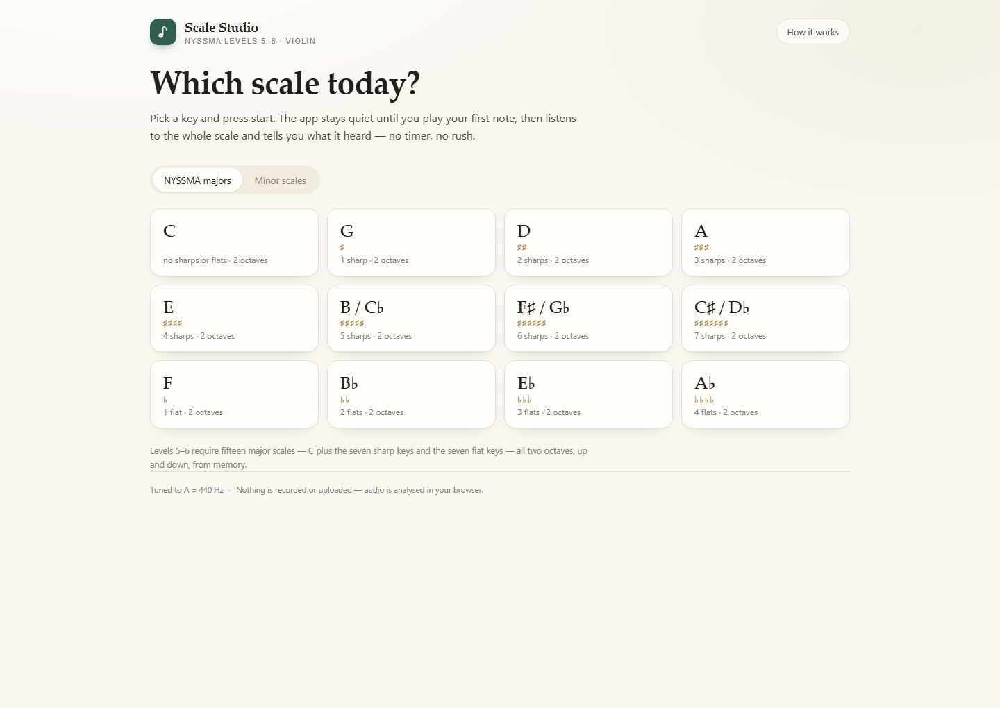

# Scale Studio

**Live:** <https://appleknife.github.io/scale-studio/> — works on phones and tablets.



A listening scale trainer for violin students preparing for **NYSSMA Levels I–VI**.

Pick a key, press *Start listening*, and play. The app waits until you actually
begin — there is no count-in and no timer — then follows the scale note by note
and shows a percentage with specific, encouraging feedback: which notes sat
high or low, whether the pulse wandered, and where you stopped.

Everything happens in the browser. No audio is recorded, stored or uploaded.

---

## Running it

The microphone is only available to pages served from `localhost` (or HTTPS), so
the app needs to be opened through the little server that ships with it rather
than by double-clicking `index.html`.

**Windows:** double-click **`Start Scale Studio.cmd`**. A console window opens,
your browser opens the app, and you leave the console open while practising.

That little server is not an installation — it only hands the folder's files to the
browser over `http://localhost`. Opening `index.html` by double-clicking cannot work:
the page's scripts are ES modules, which browsers refuse to load from a `file://`
origin, and microphones are only offered to secure origins (`localhost` or HTTPS). If
you do double-click it, the page now explains this instead of sitting blank.

**macOS / Linux:** from this folder run `python3 -m http.server 8777` and open
<http://localhost:8777/>.

**On a tablet or Chromebook:** open the published link above. It is served from
GitHub Pages over HTTPS, which is what lets the microphone work on iOS and
Android. Any static host would do the same — nothing here needs a server-side
language.

**Sharing it:** the link is public, and nothing is stored: audio is analysed in
the page and thrown away, and there is no account, no database and no analytics.
Students can bookmark it or add it to their home screen.

### iPhone and iPad

It runs in Safari, and Chrome/Firefox on iOS (which use the same engine). Two things
to know:

* **It must be HTTPS.** An address like `http://192.168.1.20:8777` on your home
  network will load the app but the microphone will be refused — iOS only offers it
  to secure pages, and a LAN address is not one. Publish the folder to any static
  host and open the `https://…` link.
* **Add to Home Screen** (Share → Add to Home Screen) gives it an icon and runs it
  full screen without browser chrome. The manifest and touch icon are already here.

iOS applies its own automatic gain and (on some models) voice isolation to the
microphone, so readings are marginally less precise than on a laptop — still far
inside the ±20 cents the scoring cares about. Keep the screen awake: locking the
tablet suspends audio and ends the take.

> Browsers ask for microphone permission the first time. If it was blocked, click
> the lock icon in the address bar and allow it.

---

## What the app considers

| What | Weight | How it is judged |
| --- | --- | --- |
| Notes | 56% | Every expected note is matched one-by-one against what was heard. |
| Intonation | 20% | Cents away from the centre of each note (±15¢ counts as centred). |
| Steadiness | 12% | Spread of the gaps between note onsets — an even pulse scores well. |
| Flow | 12% | Silences long enough to break the phrase. |

The scoring is deliberately generous. A whole scale played slightly sharp, or a
tempo that drifts a little, still scores in the nineties; what actually moves the
number is stopped playing, missed notes and notes in the wrong place. Anything
worth fixing becomes one of the note-by-note tips under the result.

Notes are aligned with the printed scale using sequence alignment, so one extra
note or one skipped note costs only its own slot instead of throwing off
everything that follows.

---

## Tuner

The **Tuner** button in the header opens a needle dial for the open strings. Bow one
string at a time and the app follows whichever string it hears. The green band shows
where that string should sit — which is deliberately *not* dead centre:

* **A, D and E** want a hair above the note, deliberately. Soloists tune slightly high
  because the violin sounds a little brighter and carries further, and because strings
  drift down as you play — so starting a touch high keeps you closer to pitch for
  longer.
* **G** wants a hair below. It is the string that lifts most under bow weight, and it
  still has to sit a true fifth under the D.

The screen also carries the mechanics students actually need: fine tuners first, pegs
only for a big move, always arriving at a pitch from below (ease it flat, then come up),
never overshooting, resetting a fine tuner that has bottomed out — and extra care on the
E, which snaps first.

Then the part that matters more than any number on the dial: **the fifths**. A violin
is tuned in pure fifths while a tuner is equal-tempered, so the two disagree by a
couple of cents on every string. Hold G+D, D+A and A+E as double stops and move the
upper string of each pair until the pair rings cleanly.

The three pairs are a tick-list, not a measurement. A bowed double stop always
wobbles a little — bow pressure alone moves the loudness around more than the beat
does — so any automatic "is it pure?" judgement would cry wolf. Tick each pair off
once your ear is satisfied; the app's job here is only to keep the ritual in front of
you.

## Levels

The level tabs on the chooser decide what "a scale" means for you, and they follow
the Manual's three tiers:

| Level | What the Manual asks | What the app does |
| --- | --- | --- |
| **I–II** | three distinct major scales, one octave, chosen by you | you pick three; all one octave |
| **III–IV** | seven major scales, two of them in two octaves | you pick seven and mark your two; the app draws one two-octave and two one-octave |
| **V–VI** | fifteen major scales, all two octaves, chosen by the adjudicator | three drawn at random |

Practice follows the level as well — I–II opens scales in one octave, III–VI in two —
and the **1 oct / 2 oct** switch in the scale header overrides it for any single
scale, which is handy when a student is ready to stretch one key upwards.

## Mock audition

Every audition is three scales, played back to back, with one report at the end.
How those three arrive depends on the level: at I–II you choose them, at III–IV the
app draws from your seven, at V–VI it draws from the twelve keys. At V–VI the draw
spins three reels — three distinct keys, no repeats — and then you play them one
after another, exactly as in the audition:

* the microphone opens once and stays open, so there is no re-prompting between scales;
* the **notation is hidden** — only the key name and range are shown, because the
  Manual asks for the scales "from memory without any visual aid";
* the live tuner is hidden (a judge gives nothing away);
* no score appears until the third scale is finished;
* the app waits for your first note each time, so you can breathe between scales;
* **End audition** stops early and returns to the scale list.

The report gives an average, each scale's own score with a one-line verdict, the
single most useful tip from each scale, and an encouraging line drawn at random
from a small pool. Tap any scale row to open its full breakdown — score ring,
coloured staff, all the tips.

The draw is majors only, because that is what Levels 5–6 require, and it always
uses the familiar spelling: **B**, **F♯**, **C♯** — never C♭, G♭ or D♭.

### Matching the Manual

The string requirement for Levels V–VI reads:

> Fifteen (15) major scales from memory without any visual aid · all in two octaves ·
> ascending and descending in quarter notes at a moderate speed.
> Perform: three scales, all three chosen by the adjudicator.

The app follows that shape: two octaves tonic to tonic, notation hidden in an
audition, three scales drawn for you, and a tempo check that only nudges when a take
is very slow (the Manual says "moderate", not "fast").

### Why not C♭?

Because the Manual never names its fifteen scales. It only ever says "Fifteen (15)
major scales", so the list is an inference: C plus the seven sharp keys and the seven
flat keys. That counts B/C♭, F♯/G♭ and C♯/D♭ as separate scales even though they are
the same notes with the same fingerings — which is why the count comes out as fifteen
rather than twelve.

The 2026 review ([CUNY Academic Works](https://academicworks.cuny.edu/cgi/viewcontent.cgi?article=1000&context=yc_pubs))
points out that the Manual "does not indicate which fifteen", argues for twelve, and
notes that we do not even have statistics on how often a key like C♭ has ever been
picked by an adjudicator. Flesch and Galamian both use twelve. On the ground, the
enharmonic pairs are taught as one scale: a Long Island studio's NYSSMA video series
teaches D♭ for Levels 5–6 and says outright that it "is the same exact note as C
sharp".

So C♭ is here for completeness, but it is off by default. If you want to drill it,
open the B / C♭ card on the practice screen and switch the spelling.

## The scales

Levels 5–6 for violin/viola/cello require **fifteen major scales, all two octaves,
up and down, from memory**. Three of the fifteen share a pitch set with another
spelling, so the grid shows twelve cards:

| Card | Key signature | Starts on |
| --- | --- | --- |
| C | — | C4 (3rd finger, G string) |
| G | 1♯ | G3 (open G) |
| D | 2♯ | D4 (open D) |
| A | 3♯ | A3 (open A) |
| E | 4♯ | E4 (1st finger, D string) |
| B / C♭ | 5♯ / 7♭ | B3 (2nd finger, G string) |
| F♯ / G♭ | 6♯ / 6♭ | F♯4 (high 2nd finger, D string) |
| C♯ / D♭ | 7♯ / 5♭ | C♯4 (2nd finger, A string) |
| F | 1♭ | F4 (low 2nd finger, D string) |
| B♭ | 2♭ | B♭3 (low 2nd finger, G string) |
| E♭ | 3♭ | E♭4 (low 1st finger, D string) |
| A♭ | 4♭ | A♭3 (high 1st finger, G string) |

The **Minor scales** tab is extra (NYSSMA does not ask for them at these levels,
but a lot of the repertoire is minor) with natural, harmonic and melodic forms.

If your studio starts a scale in a different octave, change the `octave` value for
that key in [`src/music.js`](src/music.js) — the staff, the listening target and
the scoring all follow from it.

---

## How it listens

* **Pitch detection:** YIN (cumulative mean normalized difference) over a 2048-sample
  window, sampled about 30 times a second. It is monophonic and vibrato-tolerant;
  it reports the centre of a vibrato, not the wobble.
* **Note finding:** a note begins when a stable pitch appears and ends when the
  pitch moves or the sound stops. The first 20% and last 15% of each note are
  ignored so bow attacks do not distort the reading.
* **Scoring:** sequence alignment + per-note cents, onset spacing and gaps.

Tuning decisions live in `DEFAULTS` at the top of
[`src/analyze.js`](src/analyze.js) — for example `intonationPerfect: 15` and
`intonationZero: 55` control how strict intonation is, and `weights` sets the four
percentages above.

---

## Practical tips for students

* A quiet room and a microphone within a metre or two of the instrument is plenty.
* Don't hold back — a confident, even bow is easier for the app (and the
  adjudicator) to read than a cautious one.
* Let the first note ring for a moment; the take starts on the first sustained
  pitch it hears.
* Press **Finish early** if you want to stop a take without waiting for silence.
* If you have several microphones, the browser remembers the choice **per site**.
  Change it in the padlock/aA menu → Site settings → Microphone, then press *Start
  listening* again (a take already running stays on the old input).

Closing the console window (or Ctrl+C) stops the server, and the page stops loading
until you start it again. If port 8777 is already taken, run
`powershell -ExecutionPolicy Bypass -File server.ps1 -Port 9000` and open
<http://localhost:9000/>.

## Files

```
index.html            the three screens
app.css               visual design
src/music.js          note spelling, key signatures, scale library
src/pitch.js          YIN pitch detector
src/analyze.js        note segmentation, alignment, scoring, feedback
src/tuner.js          open-string targets and the fifth checklist
src/staff.js          treble-staff renderer (SVG)
src/app.js            screens, microphone, results
tests/dsp.test.html   synthesised-audio tests for the detector and scoring
tests/ui.test.html    click-through smoke test, including the mock-audition draw
tests/lab-server.ps1  test server that collects results from a headless browser
server.ps1            the local server used by Start Scale Studio.cmd
```

`tests/dsp.test.html` synthesises a violin-like scale in the browser, runs it
through the real detector and scorer, and reports pass/fail for a clean take,
out-of-tune notes, uneven timing with a pause, a skipped note, a wrong octave and
a slow-but-accurate performance.

---

## Limits worth knowing

* Monophonic only — no double stops or chords.
* Very short notes (faster than about sixteenths at ♩=120) may be merged.
* Laptop microphones vary; a student recorded very quietly may lose notes.
* It is a practice mirror, not an adjudicator: tone, bowing and musical shape are
  still your ears' job.

The treble clef glyph in `src/clef.js` is from
[Wikimedia Commons](https://commons.wikimedia.org/wiki/File:Treble_clef.svg)
(public domain).
